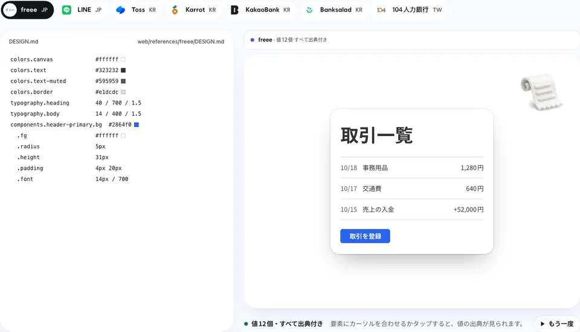

<p align="center">
  <picture>
    <source media="(prefers-color-scheme: dark)" srcset="docs/brand/banner-dark.svg">
    
  </picture>
</p>

<p align="center"><strong>日中韓の画面のための DESIGN.md アーカイブとフロントエンドスキル</strong></p>

<p align="center">
  <a href="https://www.npmjs.com/package/oh-my-design-cli"></a>
  <a href="https://www.npmjs.com/package/oh-my-design-cli"></a>
  <a href="https://github.com/kwakseongjae/oh-my-design"></a>
</p>

<p align="center">
  日本語 · <a href="README.md">English</a> · <a href="README.ko.md">한국어</a> · <a href="README.zh-TW.md">繁體中文</a>
</p>

AI コーディングエージェントは React をそつなく書きます。でも「Toss 風」が何なのかは知らないし、「〜することができます」を一段落に三回書きます。

oh-my-design は、その両方を教えます。



<sub>一つの画面に三つの DESIGN.md：Toss（韓国）、freee（日本）、104（台湾）。画面の値はすべてアーカイブから取っています。<a href="https://oh-my-design.kr/ja">oh-my-design.kr</a> で実際に操作できます。</sub>

```bash
npx oh-my-design-cli@latest
```

Claude Code、Codex、OpenCode、Cursor で使えます。API キーも MCP サーバーも要りません。考えるのはエージェント、根拠を出すのは oh-my-design です。

## 二本の柱

**アーカイブ。** Toss、freee、メルカリ、LINE、pixiv など、実在する 500 以上のプロダクトの DESIGN.md です。ファイルごとに値の出どころの確かさで等級を付け、誰も確認できなかった値は推測で埋めずに空けておきます。[アーカイブを見る](https://oh-my-design.kr/design-systems)。エージェントは `oh-my-design.kr/<id>/design.md` から直接取得できます。

**スキル。** 日中韓を先に考えたフロントエンドスキルです。日本語の見出しは禁則を守って文節で折り返し、日中韓の大見出しは選択できる本物のテキストのまま残し、コピーは五つの言語で自然な文に整えます。インターフェースの手触り、引き算、スロップ点検も数値で行います。[スキル一覧 →](https://oh-my-design.kr/docs/ja/skills)

## 最初の60秒

1. 上のコマンドでインストールし、エージェントを再起動してスキルを読み込ませます。
2. 次のように送ります。
   > Tossを参考に、家族向け食事記録アプリのデザインシステムを提案してください。DESIGN.mdを書く前に確認を取ってください。
3. 続けて送ります。
   > このDESIGN.mdを基準にホーム画面をデザインしてください。

Toss でなくても構いません。[アーカイブ](https://oh-my-design.kr/design-systems)から別の会社を選んで、名前を差し替えるだけです。

## もっと見る

- [スキル](https://oh-my-design.kr/docs/ja/skills)：各スキルの役割、一つだけ入れる方法
- [はじめに](https://oh-my-design.kr/docs/ja/getting-started)：エージェント別のインストール、グローバル導入、`doctor`、Cursor
- [DESIGN.md](docs/guide/design-md.md)（英語）：二つの形式、システムの導き方、`omd book`
- [インストール詳細](docs/guide/install.md)（英語）：エージェント別の導入先、`update`
- [ドキュメント](https://oh-my-design.kr/docs/ja) · [変更履歴](CHANGELOG.md)

---

MIT。アーカイブの DESIGN.md は各社のデザインを記録したもので、デザインの権利は各社にあります。教育目的の参考資料として再構成しています。
