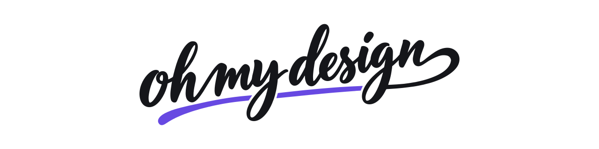
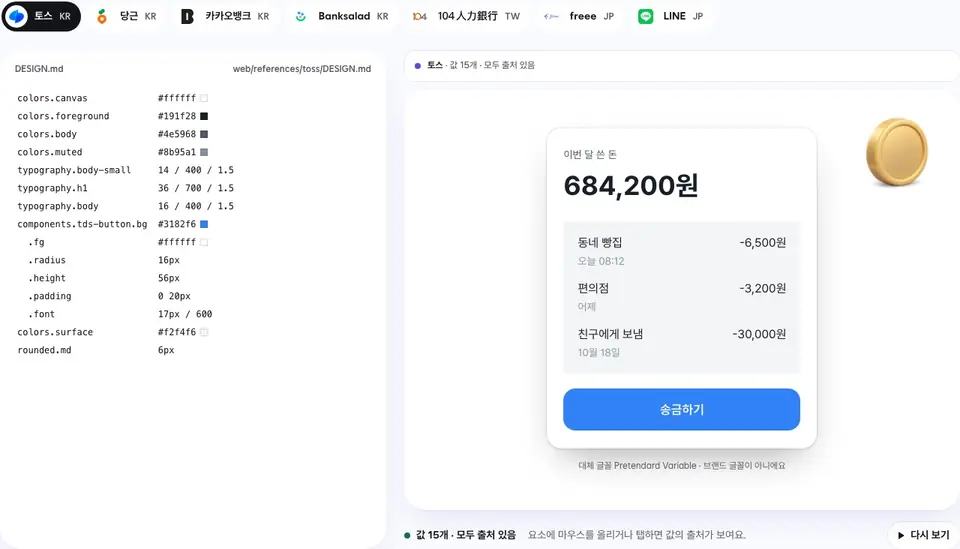

<p align="center">
  <picture>
    <source media="(prefers-color-scheme: dark)" srcset="docs/brand/banner-dark.svg">
    
  </picture>
</p>

<p align="center"><strong>한·중·일 화면을 위한 DESIGN.md 아카이브와 프론트엔드 스킬.</strong></p>

<p align="center">
  <a href="https://www.npmjs.com/package/oh-my-design-cli"></a>
  <a href="https://www.npmjs.com/package/oh-my-design-cli"></a>
  <a href="https://github.com/kwakseongjae/oh-my-design"></a>
</p>

<p align="center">
  한국어 · <a href="README.md">English</a> · <a href="README.ja.md">日本語</a> · <a href="README.zh-TW.md">繁體中文</a>
</p>

코딩 에이전트는 React를 꽤 잘 짭니다. 그런데 ‘토스 스타일’이 뭔지는 모르고, `있어요`를 `있어` / `요`로 끊어 두 줄에 걸쳐 놓습니다.

oh-my-design이 둘 다 알려 줍니다.



<sub>화면 하나에 DESIGN.md 세 개: 토스(한국), freee(일본), 104(대만). 화면에 쓰인 값은 모두 아카이브에서 왔습니다. <a href="https://oh-my-design.kr/ko">oh-my-design.kr</a>에서 직접 눌러 볼 수 있습니다.</sub>

```bash
npx oh-my-design-cli@latest
```

Claude Code, Codex, OpenCode, Cursor에서 씁니다. API 키도 MCP 서버도 필요 없습니다. 머리는 에이전트가 쓰고, 근거는 oh-my-design이 댑니다.

## 두 갈래

**아카이브.** 토스, 당근, 배민, Stripe, LINE 등 실제 서비스 500곳 이상의 DESIGN.md입니다. 레퍼런스마다 값의 출처가 얼마나 확실한지로 등급을 매기고, 아무도 확인하지 못한 값은 지어내지 않고 비워 둡니다. [아카이브 보기](https://oh-my-design.kr/ko/design-systems). 에이전트는 `oh-my-design.kr/<id>/design.md`에서 바로 가져갑니다.

**스킬.** 한·중·일을 먼저 생각한 프론트엔드 스킬입니다. 한국어는 어절 단위로 줄을 바꾸고, 한·중·일 큰 제목은 선택할 수 있는 진짜 텍스트로 남기고, 문장은 다섯 언어로 자연스럽게 다듬습니다. 인터페이스 감각, 절제, 슬롭 점검도 숫자로 합니다. [전체 스킬 →](https://oh-my-design.kr/docs/ko/skills)

## 첫 60초

1. 위 명령으로 설치하고, 에이전트를 재시작해 스킬을 불러옵니다.
2. 이렇게 보냅니다.
   > 토스 스타일로 가족 식단 공유 앱의 디자인 시스템을 제안하고, DESIGN.md를 쓰기 전에 확인해줘.
3. 이어서 보냅니다.
   > 이 DESIGN.md를 기준으로 홈 화면을 디자인해줘.

토스가 아니어도 됩니다. [아카이브](https://oh-my-design.kr/ko/design-systems)에서 다른 회사를 골라 이름만 바꾸세요.

## 더 보기

- [스킬](https://oh-my-design.kr/docs/ko/skills): 스킬마다 하는 일, 하나만 설치하는 법
- [시작하기](https://oh-my-design.kr/docs/ko/getting-started): 에이전트별 설치, 전역 설치, `doctor`, Cursor
- [DESIGN.md](docs/guide/design-md.md) (영어): 두 가지 형식, 시스템을 유도하는 방식, `omd book`
- [설치 상세](docs/guide/install.md) (영어): 에이전트별 설치 위치, `update`
- [문서](https://oh-my-design.kr/docs/ko) · [변경 기록](CHANGELOG.md)

---

[MIT](LICENSE). 아카이브의 DESIGN.md는 각 회사의 디자인을 기록한 것이고, 그 디자인은 해당 회사의 것입니다. 교육용 참고 자료로 재구성했습니다.
