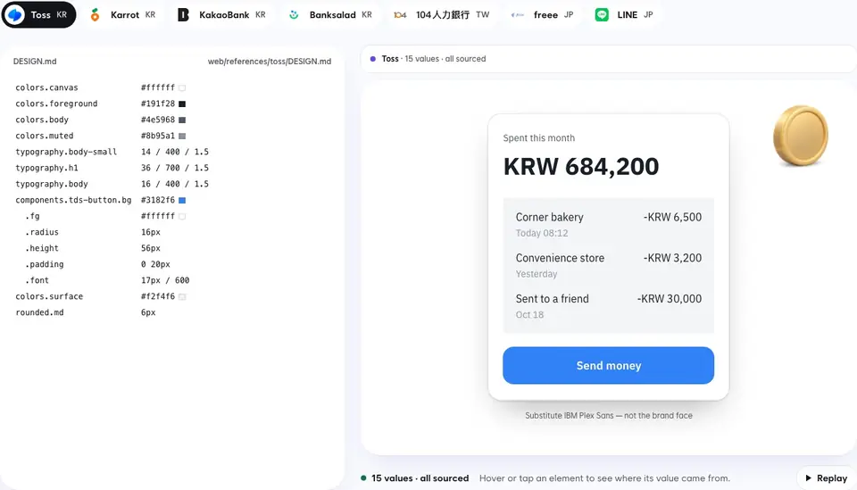

<p align="center">
  <picture>
    <source media="(prefers-color-scheme: dark)" srcset="docs/brand/banner-dark.svg">
    
  </picture>
</p>

<p align="center"><strong>A DESIGN.md archive and frontend skills for CJK screens.</strong></p>

<p align="center">
  <a href="https://www.npmjs.com/package/oh-my-design-cli"></a>
  <a href="https://www.npmjs.com/package/oh-my-design-cli"></a>
  <a href="https://github.com/kwakseongjae/oh-my-design"></a>
</p>

<p align="center">
  English · <a href="README.ko.md">한국어</a> · <a href="README.ja.md">日本語</a> · <a href="README.zh-TW.md">繁體中文</a>
</p>

Your coding agent writes good React. It has no idea what “Toss-style” means,
and it will happily break `있어요` across two lines.

oh-my-design fixes both.



<sub>One screen, three DESIGN.md files: Toss (Korea), freee (Japan), 104 (Taiwan). Every value on it comes from the archive. Try it at <a href="https://oh-my-design.kr">oh-my-design.kr</a>.</sub>

```bash
npx oh-my-design-cli@latest
```

Works in Claude Code, Codex, OpenCode and Cursor. No API key, no MCP server:
your agent brings the brain, we bring the receipts.

## Two halves

**The archive.** DESIGN.md files for 500+ real products: Toss, Stripe, LINE,
pixiv, Linear and the rest. Each one is graded by how well its values are
sourced, and the rule is simple: if nobody could confirm a value, it stays
blank. [Browse it](https://oh-my-design.kr/design-systems), or let your agent
fetch `oh-my-design.kr/<id>/design.md`.

**The skills.** Frontend skills written CJK-first. Korean that wraps between
words, never inside one. Korean, Japanese and Chinese display type that stays
real, selectable text. Copy that reads native in five languages. Plus the usual
polish, with numbers attached: interface feel, restraint, slop audits.
[All skills →](docs/guide/skills.md)

## Your first 60 seconds

1. Install (above), then restart your agent so it loads the skills.
2. Send:
   > Set up a Toss-inspired design system for a family meal-tracking app. Ask before writing DESIGN.md.
3. Then:
   > Using this DESIGN.md, design the home screen.

Not a Toss person? Swap in any company from the [archive](https://oh-my-design.kr/design-systems).

## More

- [Skills](docs/guide/skills.md): what each one does, and how to install just one
- [Install](docs/guide/install.md): each agent, global installs, Cursor, `doctor`, `update`
- [DESIGN.md](docs/guide/design-md.md): both formats, how a system gets derived, `omd book`
- [Docs](https://oh-my-design.kr/docs/en) · [Changelog](CHANGELOG.md)

---

[MIT](LICENSE). Each DESIGN.md in the archive describes a company's design, which belongs to that company; it is reproduced here for educational reference.
