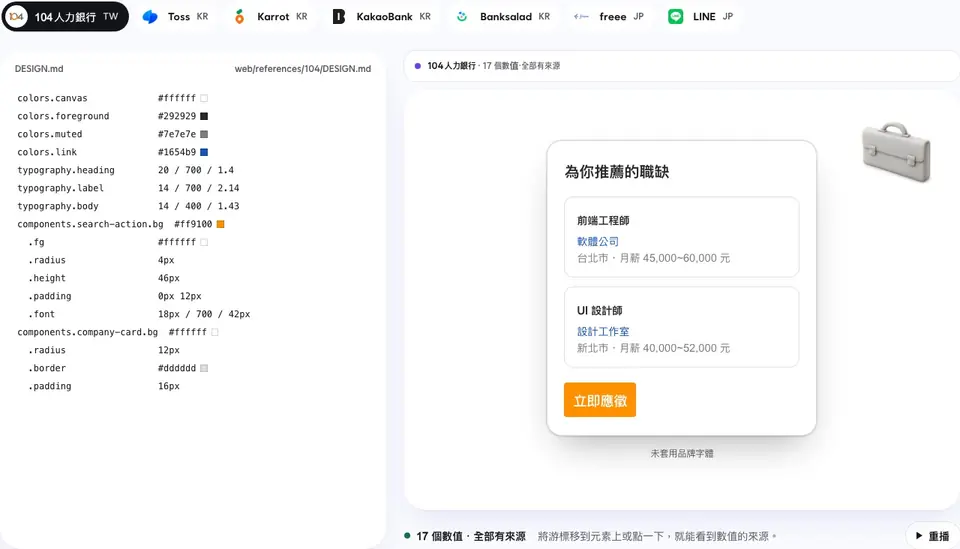

<p align="center">
  <picture>
    <source media="(prefers-color-scheme: dark)" srcset="docs/brand/banner-dark.svg">
    
  </picture>
</p>

<p align="center"><strong>給中日韓介面用的 DESIGN.md 典藏與前端技能。</strong></p>

<p align="center">
  <a href="https://www.npmjs.com/package/oh-my-design-cli"></a>
  <a href="https://www.npmjs.com/package/oh-my-design-cli"></a>
  <a href="https://github.com/kwakseongjae/oh-my-design"></a>
</p>

<p align="center">
  繁體中文 · <a href="README.md">English</a> · <a href="README.ko.md">한국어</a> · <a href="README.ja.md">日本語</a>
</p>

AI 程式助理寫 React 寫得不錯。可是它不知道「Toss 風格」是什麼，還會把「影片」寫成「視頻」。

oh-my-design 兩件事都教給它。



<sub>同一個畫面，三份 DESIGN.md：Toss（韓國）、freee（日本）、104（台灣）。畫面上的每個值都來自典藏。可以到 <a href="https://oh-my-design.kr/zh-tw">oh-my-design.kr</a> 親手試試。</sub>

```bash
npx oh-my-design-cli@latest
```

支援 Claude Code、Codex、OpenCode 與 Cursor。不需要 API 金鑰，也不需要 MCP 伺服器。動腦的是 AI 程式助理，拿出依據的是 oh-my-design。

## 兩大支柱

**典藏。** Toss、LINE、104、pixiv、Stripe 等 500 多個真實產品的 DESIGN.md。每份檔案依其中數值的來源有多可靠來分級；沒有人能確認的值就留白，不拿猜測來補。[瀏覽典藏](https://oh-my-design.kr/design-systems)。AI 程式助理也能直接讀取 `oh-my-design.kr/<id>/design.md`。

**技能。** 先為中日韓設想的前端技能：韓文不在詞中間斷行，中日韓大標題保留為可選取的真實文字，文案以五種語言改寫成在地說法，台灣用語也照顧到。另外還有介面手感、減法、slop 檢查，全部用數字說話。[所有技能 →](https://oh-my-design.kr/docs/zh-tw/skills)

## 最初 60 秒

1. 用上方指令安裝，再重新啟動 AI 程式助理，讓它載入技能。
2. 傳送：
   > 參考 Toss，為家庭飲食記錄應用設計一套設計系統。寫入 DESIGN.md 前先向我確認。
3. 接著傳送：
   > 以這份 DESIGN.md 為依據，設計首頁。

不想用 Toss？從[典藏](https://oh-my-design.kr/design-systems)挑另一家公司，換掉名字就好。

## 延伸閱讀

- [技能](https://oh-my-design.kr/docs/zh-tw/skills)：每個技能做什麼、只裝一個的方法
- [開始使用](https://oh-my-design.kr/docs/zh-tw/getting-started)：各工具的安裝、全域安裝、`doctor`、Cursor
- [DESIGN.md](docs/guide/design-md.md)（英文）：兩種格式、系統如何推導、`omd book`
- [安裝細節](docs/guide/install.md)（英文）：各工具的安裝位置、`update`
- [文件](https://oh-my-design.kr/docs/zh-tw) · [更新紀錄](CHANGELOG.md)

---

[MIT](LICENSE)。典藏中的 DESIGN.md 記錄的是各企業的設計，設計歸各企業所有，僅為教育性參考而重現。
